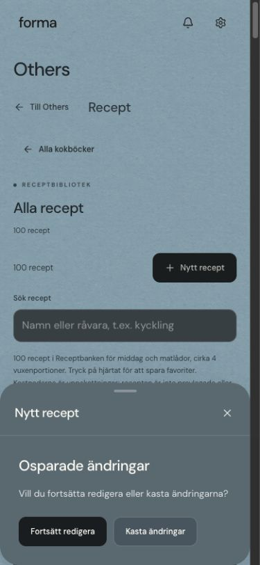
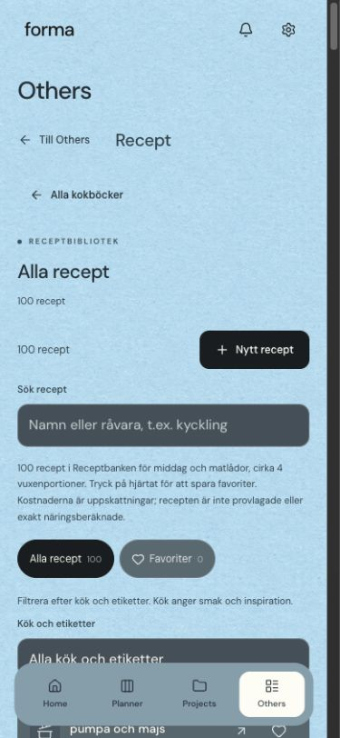

# Granskning av Forma — 26 oktober 2026

## Omfattning

Granskning av den lokala produktionsbyggda appen: Home/Inställningar, Planner-relaterade dialoger, projekt, kokböcker/recept, anteckningar, väder och övertid. Prioritet: dataförlust, fel mellan flikar, läsbarhet och mobilanvändning. De fyra senaste användarönskemålen för Bento blå (blå bakgrund, transparent header, enbart aktiv menyruta och gröna avbockade vanor) har bevarats.

## Flöde och verifierade fynd

1. **Recept → Nytt recept → skriv en titel → stäng. P1: osparade ändringar försvann utan varning.** Reproducerat i webbläsaren och i ett nytt regressionstest. Receptredigeraren använder nu samma bekräftelse för osparade ändringar som övriga redigerare, även via Avbryt. Sparande blockeras också medan en bild förbereds. Efterkontroll: Fortsätt redigera behåller utkastet; Kasta ändringar är ett uttryckligt val.

   

2. **Öppna samma eget recept i två flikar → redigera i B → radera i A → spara B. P1: det raderade receptet återuppstod.** Bekräftat av ett isolerat test före korrigering. Orsak: receptets ursprungliga snapshot kastades bort när posten inte längre fanns i arbetsytan. Snapshot behålls nu för egna recept; endast nya katalogöverlagringar hanteras utan tidigare sparad post. Nya kopior av katalogrecept får rätt identitet som nya poster. Efterkontroll i Chromium och WebKit: posten förblir raderad och redigeraren visar ett fel; katalogkopior kan fortfarande sparas.

3. **Receptbibliotek i Bento blå. P2: ljusa fältetiketter låg direkt mot den ljusblå bakgrunden.** Sök- och filteretiketter var svåra att läsa; uppmätt kontrast före korrigering 1,23:1. De får nu mörk text. Ljusa etiketter behålls inne i mörka dialoger och kostkalendern. Regressionstestet kontrollerar minst 4,5:1 för de berörda etiketterna.

   

4. **Bento blå → inaktiva navigationsval. P2: ljusa, små menytexter hade låg kontrast mot menyraden.** Inaktiva ikoner och texter använder nu mörk färg; enbart det aktiva valet har fortfarande en ruta. Tangentbordsfokus får en mörk kontur. Kontrasttestet kräver minst 4,5:1.

## Genomförda kontroller

- `npm run build`: godkänt efter produktkorrigeringarna.
- `npm test`: samtliga befintliga domän-/dataintegritetstester godkända under granskningen.
- `tests/audit-regressions.cjs`: fyra kontroller godkända i både Chromium och WebKit: utkastvarning, tvåflikarsradering, katalogkopiering och kontrast inklusive kostkalenderns etiketter.
- Kokböcker: omslagsuppladdning, flera böcker, nya/befintliga recept, omladdning och bevarat bibliotek godkända i Chromium efter korrigeringen.
- Anteckningar: alla sju befintliga scenarier godkända, inklusive autosparande, lagringsfel, länkar mellan moduler och smala redigerare.
- Väder: sju scenarier vardera i WebKit och Chromium godkända, inklusive mobil, iPad-viewport, nattläge och reservkälla.
- Projektredigering och ikonväljare: godkända. Tre äldre tester uppdaterades för verkligt nuvarande UI: explicit Kasta ändringar, öppna ikonsektionen och texten ”huvuduppgifter klara”.
- Projektsidor: sex scenarier vardera i WebKit och Chromium godkända.
- Övertid: registrering över midnatt, saldo, uttag/återställning, redigering, radering och omladdning godkända.
- Visuell efterkontroll: Chrome, 1280 × 845 och 390 × 844. In-app browser användes före avbrottet; efter avbrottet användes Chrome när den inte längre var tillgänglig. Färska skärmbilder sparade från denna granskningsomgång.
- Inga konsolfel i den manuellt granskade eftervyn.

## Underlag

- `audit-2026-10-26/recipes-before.png`: svårlästa etiketter före korrigering.
- `audit-2026-10-26/recipes-after-desktop.png`: läsbara etiketter efter korrigering.
- `audit-2026-10-26/recipes-after-mobile.png`: mobil vy efter korrigering.
- `audit-2026-10-26/recipe-draft-after.png`: utkastvarning.

## Begränsningar

Detta är en riktad granskning, inte ett påstående om att hela appen är felfri eller fullständigt tillgänglighetscertifierad. Kontosynk mot verkliga inloggade konton och fysiska iPhone/iPad-enheter ingår inte i slutkontrollen. Parallella, pågående ändringar för dagsschema i samma arbetsmapp ingår inte i dessa fynd eller i beskrivningen av korrigeringarna. Ingen publicering, commit eller push har gjorts i denna uppgift.

De reproducerade felen ovan är åtgärdade och har regressionstäckning.
