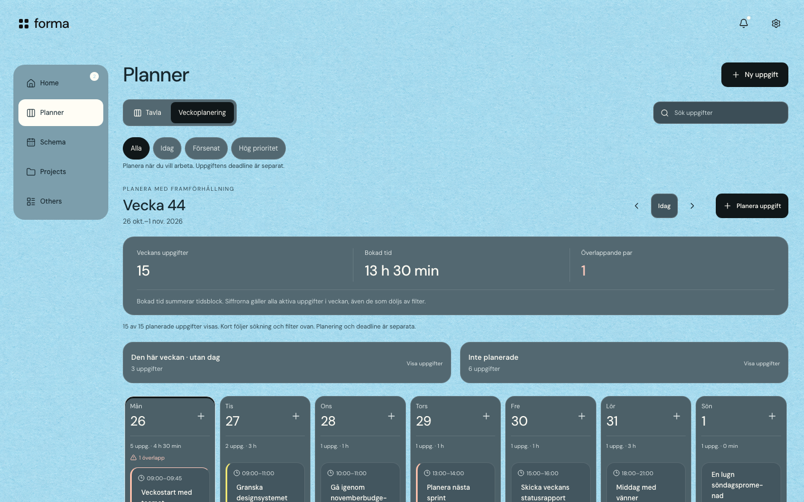
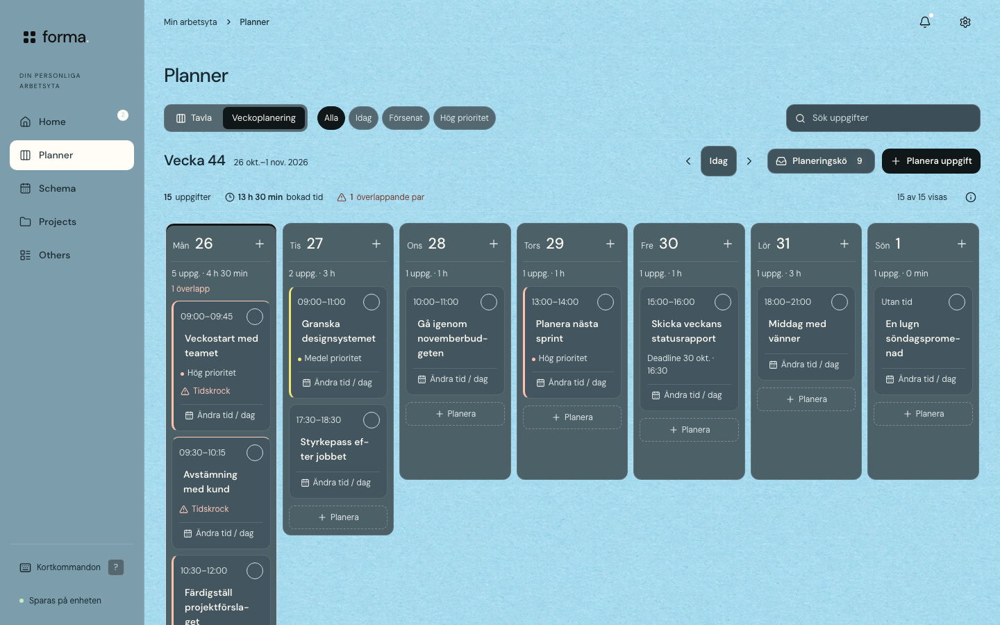
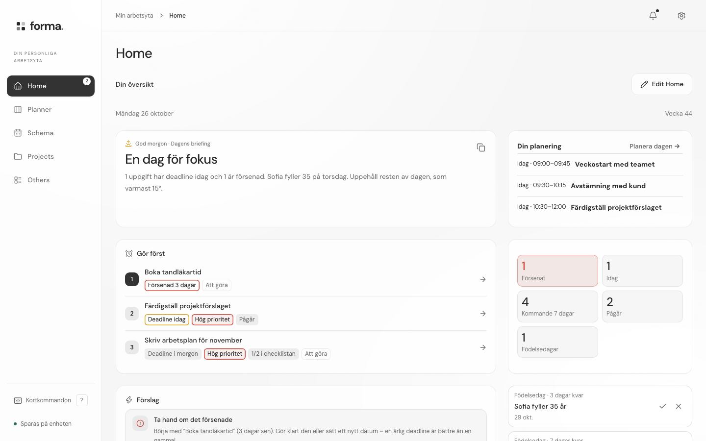
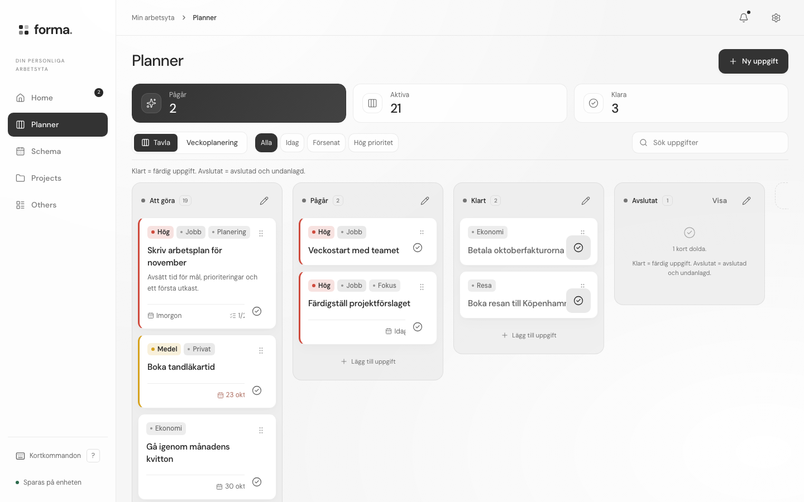
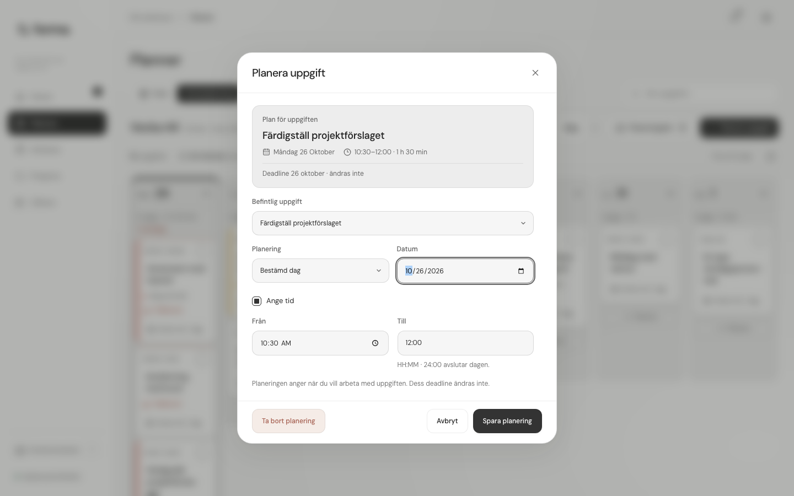
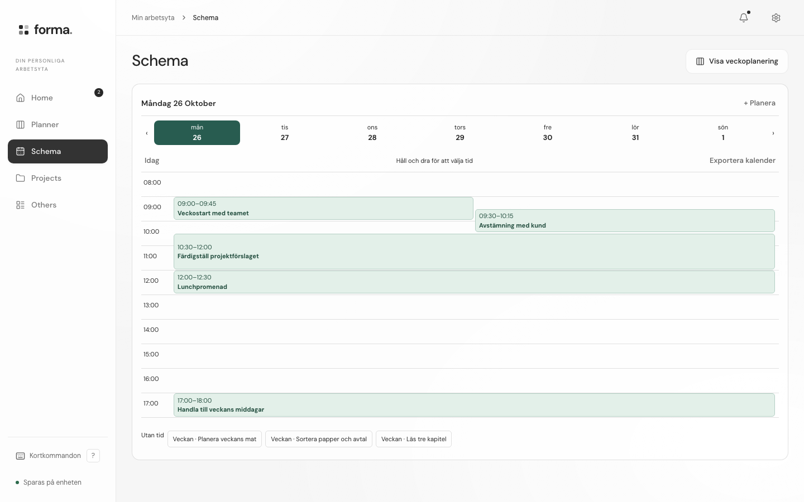
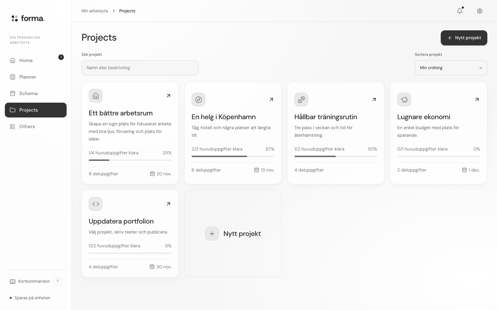
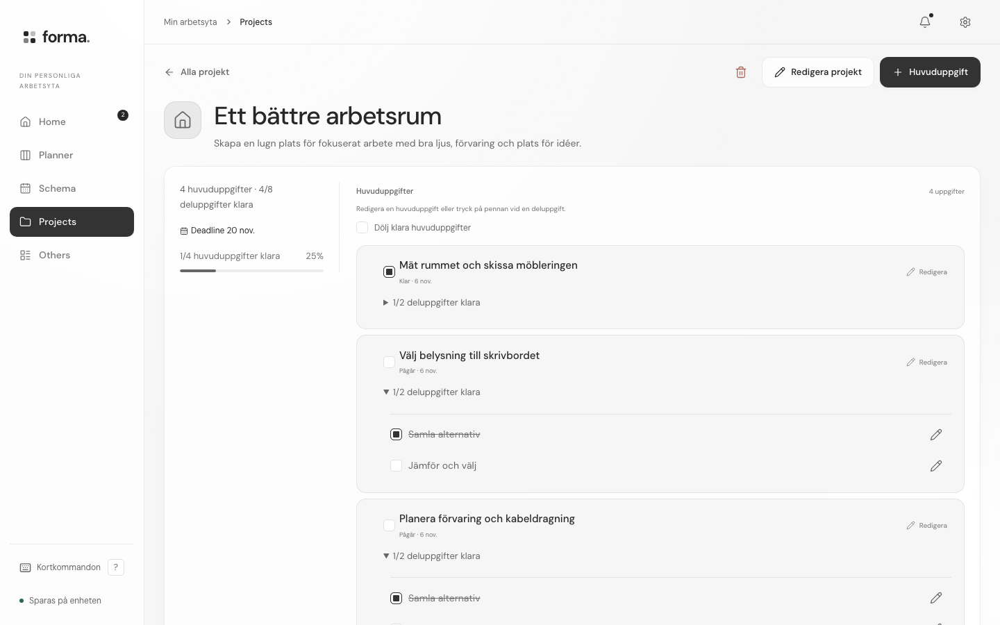
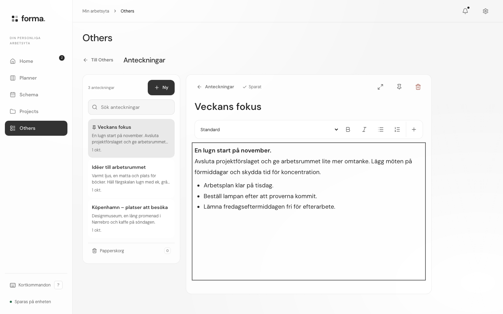

# Forma PC: UI/UX-granskning och ombyggnad

26 oktober 2026. Arbetsyta: den lokala appen. Målet är en väl genomarbetad PC-produkt med användbar planering, snarare än bara större mobilkort.

## Vad granskningen visade

Två specialistagenter granskade visuellt hantverk respektive interaktion och tillgänglighetsrisker. En separat domare satte kriterierna och prövade planen. Deras oberoende analys av färska bilder gav ett viktat utgångsbetyg på **4,65/10**: funktionerna fanns, men den huvudsakliga arbetsytan låg för långt ner, viktig text var liten och nästa handling var otydlig.

| Brist i underlaget | Före | Genomförd ändring |
| --- | --- | --- |
| Veckans uppgifter hamnar under stora rubriker, siffror och köer | Kalenderns överkant vid cirka 710 px på 1440×900 och 1280×800 | Kalendern börjar vid **321 px** i båda storlekarna. Kompakt verktygsrad och statistik, kö bredvid veckan vid behov. |
| Flera lika starka handlingar | Ny uppgift och Planera uppgift båda primära | **En primär planeringsknapp** i veckovyn. Skapa utan datum finns i tavlan och via kortkommando. |
| Typografisk tyngd på fel innehåll | Uppgiftstitlar 12 px, viktig metadata 10 px | Titlar **14 px**, metadata **12 px**. Mindre ytor runt informationen, mer plats för arbetsinnehåll. |
| Dagens fokus ligger efter stora informationsytor | Briefingen börjar omkring 783 px på 1440×900 | PC:s standardlayout lägger briefing, planering och Gör först före väder och notiser. Egna sparade Home-layouter bevaras. |
| Enkel avslutning kräver flera steg | Öppna uppgiften, ändra status, spara | **Klarmarkera direkt i veckan**, med befintlig Ångra. |
| Planeringsformuläret saknar beslutstöd | Fokus på uppgiftsväljaren, inget förhandsbesked om krockar | Fokus på titel för nytt och datum för befintligt. Kontext, deadline, varaktighet och överlapp visas före sparning. |
| PC-anteckningar tappar sitt sammanhang | Redigeraren täcker hela fönstret direkt | Lista och text ligger bredvid varandra. Fokusläge väljs aktivt på PC; touch behåller helskärmsflödet. |
| Projektverktygen utnyttjar inte bredden | Sökfält cirka 156 px, stor sparsam metadatakolumn | Sökfält 340 px och smalare projektöversikt med mer plats för uppgifter. |

## Före och efter: samma veckoinnehåll, samma PC-storlek

De här två bevarade bilderna visar samma påhittade arbetsvecka i 1440×900, i Bento. De är faktiska webbläsarbilder från denna granskning.

**Före:** arbetsinnehållet börjar långt ner och huvudhandlingarna konkurrerar.



**Efter:** arbetsytan börjar vid 321 px. Sju dagar finns kvar, uppgifter kan klarmarkeras direkt och planeringskön öppnas bredvid veckan.



## Granskade steg

### 1. Home – förbättrad och verifierad

Dagens briefing, planering och Gör först prioriteras i PC:s standardlayout. Redigerbara moduler behåller sina kontroller och sparade storlekar. Testet ändrar en modul, sparar, laddar om och kontrollerar resultatet. Väder, notiser och övriga moduler finns kvar. En sparad egen layout har företräde framför den nya standardordningen.



### 2. Planner, tavla – förbättrad och verifierad

Fast sammanhängande sidonavigation, kompakt sidhuvud, tydligare uppgiftstext och större etiketter. Tavlan har kvar dragning, status, sökning och sina filter. N öppnar en ny uppgift och / fokuserar sökningen på PC. Kortkommandon ignoreras i skrivfält, redigerbar text, öppna dialoger, fokusläge och vid modifierartangenter eller upprepade tangenttryckningar.



### 3. Planner, vecka – förbättrad och verifierad

Vecka, datum, navigering, kö och en primär handling ryms i en kompakt rad. Bokad tid och överlapp räknar fortsatt alla aktiva uppgifter, även när kort filtreras bort. Hjälpknappen förklarar siffrorna. Alla sju dagar finns kvar. På mindre PC-fönster rullas veckan i sin egen yta; hela sidan får ingen horisontell överströmning.

Planeringskö öppnar uppgifterna bredvid veckan och ändrar inte kalenderns höjdläge. En tom cirkel markerar den direkta klarmarkeringen; hovring eller tangentbordsfokus visar handlingen. Testet klarmarkerar och ångrar, inklusive kontroll av oförändrad planering.


### 4. Planera och ändra en uppgift – förbättrad och verifierad

Formuläret visar vilken uppgift som planeras, valt datum, tidsintervall, varaktighet och separat deadline. Överlapp visar berörda aktiva uppgifter innan sparning. Det är ett beslutsstöd: avsiktliga överlapp får sparas. Angränsande tidsblock ger ingen varning. Saknade datum, felaktiga intervall och 24:00 hanteras med samma validerade datamodell som tidigare.

Fokus hamnar på Titel för en ny uppgift och Datum för en befintlig. Utkast och osparat-skydd finns kvar när fönstret ändrar storlek. Senaste data används vid sparning; uppgifter som raderats eller blivit klara i en annan flik avvisas.



### 5. Schema – bevarat och förtydligat

Schema är fortsatt den egna destinationen för dag och klockslag. PC har en direkt länk till veckoplaneringen. Telefon och surfplatta behåller sina dag- och touchkontroller. Den gemensamma länken på iPadens hemskärm fick åter en touchyta på minst 44 px; hemskärmstesterna kontrollerar båda orienteringarna.



### 6. Projekt – förbättrade och verifierade

Sökfältet är användbart i PC-bredd. Kort, framsteg och uppgifter följer samma typografi och tätare ytor. Projektdetaljen har en smalare översikt och mer plats för huvud- och deluppgifter. Projekt och Planner behåller sina separata uppgifter.





### 7. Anteckningar – förbättrade och verifierade

På PC ligger listan kvar medan texten skrivs och sparas. Fokusläget är ett val, med möjlighet att lämna det utan att stänga anteckningen. Telefon och surfplatta behåller den tidigare helskärmsredigeraren. Testerna kontrollerar sparning och återgång i båda enhetstyperna. Separata domäntester kontrollerar bland annat samtidiga ändringar och skydd mot raderade anteckningar.



## Mätbara kvalitetskrav

Domarens krav skiljer produktens egna kvalitetsmål från tillgänglighetsstandarder. Kalender vid högst 360 px, titlar på minst 14 px och metadata på minst 12 px är **projektmål**, inte WCAG-regler. Gränserna för normal textkontrast och pekmål grundas i [W3C:s kontrastförklaring](https://www.w3.org/WAI/WCAG22/Understanding/contrast-minimum.html) och [förklaring av minsta målstorlek](https://www.w3.org/WAI/WCAG22/Understanding/target-size-minimum).

| Kontroll | Slutresultat |
| --- | --- |
| Kalenderns överkant, 1280×800 / 1440×900 / 1920×1080 | 321 / 321 / 321 px |
| PC-bredder med fungerande och synligt arbetsinnehåll | 1100, 1280, 1440, 1920 px |
| Titel / viktig metadata | 14 / 12 px |
| Fullständigt uppgiftskort och handling inom första skärmen | Godkänt i kontrollerade PC-storlekar |
| Vertikal förskjutning när kön öppnas | Högst 8 px, testat |
| Primär handling i veckans huvudinnehåll | En |
| Lägsta uppmätta kontrast bland kontrollerade veckotexter, ljust / mörkt | 4,97:1 / 6,78:1 |
| Lägsta uppmätta kontrast bland kontrollerade veckotexter, Bento / Aurora | 5,32:1 / 10,95:1 |
| Direkt klarmarkering, Ångra, varningspreview, relevant initialfokus | Godkänt |
| Tangentbordsflöde, återställt fokus efter dialog, säkert skrivande | Godkänt i Chromium och WebKit |
| Inga dokumentöverströmningar i kontrollerade flöden | Godkänt |

Kontrastmätningen gäller uppgiftstitel, tid, metadata, dagsstatistik och uppgiftsvarning på deras beräknade bakgrundsytor. Den utgör inte en fullständig tillgänglighetscertifiering och bedömer inte varje pixel i en bakgrundsbild. Fokus, mål, läsordning, zoom och hjälpmedel behöver fortsatt bedömas i verklig användning.

## Testresultat

- **7/7 grundscenarier för PC i Chromium och 7/7 i WebKit.** Skapa, ändra och ta bort planering; bevara deadline och innehåll; hantera felaktiga tider, andra flikar och utkast vid storleksbyte; skilja PC från touch.
- **7/7 nya hantverks- och UX-scenarier i Chromium och 7/7 i WebKit.** Kalenderplacering, typografi, huvudhandling, stabil kö, klarmarkering och Ångra, formulärpreview och fokus, kortkommandon, redigerbar Home, projektsökning, anteckningar på PC och touch, samt uppmätt kontrast i fyra teman.
- **10/10 befintliga hemskärmsscenarier i WebKit.** Liggande/stående iPad, touchytor, sparning, idle-beteende, inställningar och läsbarhet.
- `npm test`, anteckningarnas domäntester och produktionsbygget går igenom.
- Slutlig bildinsamling: **42 vybilder, 0 sidfel**, på 24 påhittade uppgifter, 5 projekt och 3 anteckningar. Användarens riktiga uppgifter eller webbläsarprofil användes inte.

Reproducerbara kommandon, med lokal server på port 4173:

```sh
npm test
npm run build
npm run test:desktop
npm run test:desktop-craft
node tests/homescreen-acceptance.cjs
node tests/desktop-audit-capture.cjs after
```

Mätdata och bildindex finns i `after/manifest.json`. Tidigare geometrimätningar finns i `before/manifest.json`; bevarade före-bilder för jämförelse finns för mörkt tema och Bento. Testresultat och kontrastmätningar skrivs till `tests/artifacts/<motor>/desktop-craft/`.

## Bedömningens gränser

Agenterna genomförde den oberoende analysen, och domaren godkände den reviderade planen med tydliga gränsvärden. Agenternas senare körningar stoppades av kontots användningsgräns. Huvudagenten slutförde implementation, reparationer, bildgranskning och tester mot kriterierna. **Det finns därför inget nytt oberoende domarbetyg för slutversionen.**

Målet 10/10 har använts som ambitionsnivå för hantverket, inte som ett påstått resultat från användartester. Faktisk uppgiftstid, förståelse, långvarig användning, skärmläsare och fysisk Windows-/iPad-hårdvara ingick inte. För egna omflyttade Home-moduler är visuell ordning och sparning verifierade; skärmläsarens läsordning efter anpassningen behöver en separat kontroll. Den äldre generella `tests/acceptance.cjs` har fortsatt den redan dokumenterade föråldrade checklisteetiketten; den används inte som kvalitetsbevis här.

Nästa praktiska utvärdering är att planera en verklig arbetsvecka och följa de punkter där användaren fortfarande behöver stanna upp.
