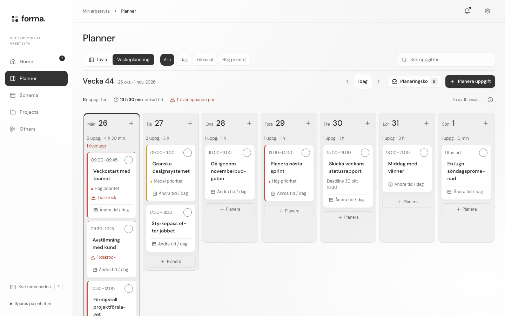

# PC, surfplatta och mobil

**Vidareutveckling:** [UI/UX-granskningen](desktop-audit/report.md) beskriver den senaste ombyggnaden av arbetsytan. Köerna öppnas nu bredvid veckan, och anteckningar har ett separat PC-flöde med valbart fokusläge. Beskrivningen nedan dokumenterar det första PC-bygget.

Byggd 26 oktober 2026 efter två planerings- och domarvarv, följt av granskning av kod, skärmbilder och faktiska sparflöden.

## Enhetsindelning

| Läge | Villkor | Upplevelse |
| --- | --- | --- |
| PC | Fönster minst 1100 px brett, primär precis pekare och stöd för hovring | Fast sidonavigation med synliga namn, större arbetsyta och val mellan Tavla och Veckoplanering i Planner. |
| Surfplatta | Primär touchpekare, minst 700 × 600 px för hemskärm | Befintlig dockad Home, stora touchytor, dagschema och navigation längst ner. En stor iPad blir inte PC enbart genom sin bredd. |
| Mobil / kompakt fönster | Smalare fönster eller otillräckligt utrymme för surfplattans hemskärm | Befintlig kompakt navigation, kolumnflikar och dagschema. Även en telefon i landskap behåller touchflödet. |

En hybrid-PC följer sin **primära** pekare. Ett uttryckligt val av Hemskärm → På har företräde framför PC-läget när hemskärmen får plats; den befintliga återgången till Home efter inaktivitet gäller då fortfarande. Hemskärm och valet av planeringsvy sparas per webbläsare/enhet.

När ett PC-fönster blir smalare visas den kompakta tavlan igen. Påbörjad veckoplanering finns kvar i samma dialog. Valet av Tavla/Veckoplanering återkommer när fönstret blir större. Bytet kräver ingen konvertering eller kopiering av uppgifter.

## Djupare planering

Öppna **Planner → Veckoplanering** på PC:

- Sju dagar, måndag till söndag, med föregående/nästa vecka och Idag. Även månadsskiften och årsskiften följer lokal kalender.
- **Den här veckan · utan dag** samlar uppgifter som ännu inte fått en dag. **Inte planerade** innehåller bara aktiva uppgifter som saknar planering helt. Uppgifter med en annan planerad vecka flyttas inte tyst till dessa köer.
- På vanliga PC-skärmar är köerna hopfällda till tydliga rubriker och antal. Välj Visa uppgifter för att öppna dem. Från 1680 px ligger de bredvid veckan och börjar öppna. Veckans dagar kan vid behov rullas i sin egen yta, även med tangentbordet.
- Planera en ny uppgift med knappen överst eller vid önskad dag. Planera en befintlig uppgift från kön eller välj den i formuläret. Ändra planering på ett kort öppnar dess befintliga värden. Ta bort planering återför uppgiften till den oplanerade kön.
- Uppgifterna kan få en dag, ett tidsblock eller en vecka utan bestämd dag. Veckodatum normaliseras till måndag. Sluttiden 24:00 är tillåten, övriga sluttider måste ligga efter starttiden.
- Bokad tid är summan av uttryckliga tidsblock, inte ledig kapacitet. Överlappande block räknas som par och märks på berörda kort. Två block där det ena slutar exakt när det andra börjar krockar inte.
- Sökning och de befintliga filtren styr vilka kort som visas. Antal, bokad tid och överlapp räknas alltid på **alla aktiva uppgifter** i perioden, så ett dolt kort inte ser ut som ledig tid. Dag- och veckotal inkluderar uppgifter utan tid; avslutade och klara uppgifter räknas inte.

Planering och deadline är separata. Omplanering ändrar bara `Task.schedule` och bevarar senaste titel, status, beskrivning, etiketter, checklista, kommentarer och deadline. Befintlig lokal lagring och molnsynk används utan nya tabeller eller migreringar. En uppgift som blivit klar eller raderats i en annan flik får inte planeras från ett gammalt formulär.

Dialogen varnar innan ändrade utkast kastas, även vid Escape eller klick utanför. Den kan användas med tangentbord och överlever ett byte mellan PC och kompakt layout. Vid sparfel finns formuläret kvar.

## Granskningsvarv

1. Produktagenten föreslog veckovy, köer och fast navigation. Domaren krävde pekarbaserad enhetsindelning, tydlig skillnad mot deadline och regler för filtrerad belastning.
2. Planen preciserades med fullständiga veckor, strikt överlapp, förifylld omplanering, kontroll av senaste aktiva uppgift och dialog utanför den responsiva layoutgrenen. Båda godkände byggstart; fler funktioner skulle inte förbättra kärnflödet tillräckligt för denna ändring.
3. Första bygget testades i Chromium och WebKit. Granskningen hittade för smala dagskort, en äldre breddstyrd Bento-navigation, svag kontrast och en kalender för långt ner på vanliga PC-skärmar. Korrigerat med större läsbredd, en gemensam PC-indelning, mörkare dagsytor och utfällbara köer.
4. Slutkontroll använder isolerade testarbetsytor, sparning och återladdning, verkliga ändringar mellan två flikar, tangentbord, storleksbyte och tre teman.

## Verifiering

Slutresultat: 7 av 7 PC-scenarier godkända i Chromium och 7 av 7 i WebKit. iPadens befintliga hemskärmstester: 10 av 10 i WebKit. Typkontroll, domäntester och produktionsbygge godkända. Domaren godkände slutresultatet utan kvarvarande P1/P2-fynd.



```sh
npm run check
npm test
npm run build
# Med utvecklingsserver på port 4173:
npm run test:desktop
node tests/homescreen-acceptance.cjs
```

`tests/week-planner.mjs` ingår i `npm test`. Det kontrollerar lokala veckogränser, köernas separation, ofiltrerad belastning, överlapp, midnatt, avslutade uppgifter, validering och oförändrade indata.

`tests/desktop-acceptance.cjs` kör sju sammanhängande scenarier per webbläsarmotor. De omfattar PC från 1100 till 1920 px, kompakt gräns 1099 px, stor touchsurfplatta, stående surfplatta, telefon i landskap, uttrycklig hemskärm, ljust/mörkt/Bento, skapa/ändra/ta bort planering, oförändrad deadline, filter, felaktiga tider, tomt datum, 24:00, Escape, storleksbyte, omladdning och ändringar från andra flikar. Resultat och skärmbilder sparas under `tests/artifacts/<motor>/desktop/`.

Den äldre allmänna `tests/acceptance.cjs` har en föråldrad exakt checklisteetikett (`Jämför alternativ`, medan formuläret redan använder `Markera … som klar`). Den körningen avbröts efter följdfel från det uteblivna testkortet. Den används inte som bevis för denna ändring; de nya PC-testerna och hemskärmstesterna verifierar ändringens berörda flöden.

Ingen publicering eller fysisk testning på Windows/iPad-hårdvara ingår. PC betyder här appens responsiva webbläsarläge på dator.
