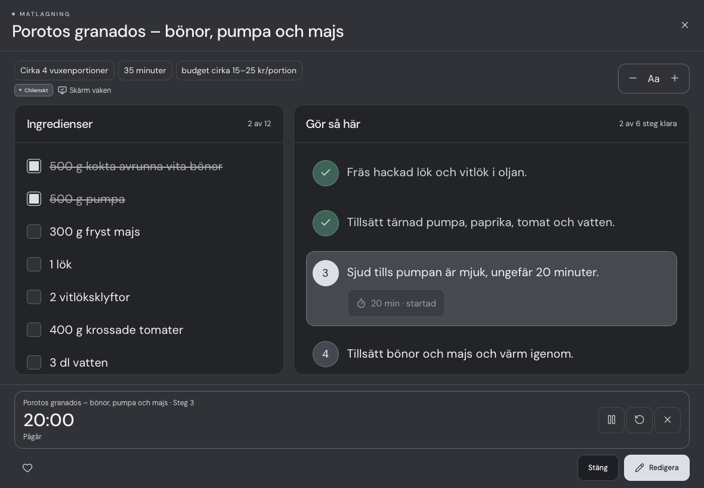

# Recept på köksbänken

Det öppnade receptet fyller den tillgängliga iPad-vyn. På PC och surfplatta visas en egen bred bildsektion överst när receptet har en bild. Under den visas ingredienser och Gör så här i två kolumner, även på stående iPad. Från 700 × 600 px har kolumnerna separata rullytor. Mobilen får en kompakt miniatyr, staplade rutor och snabblänkar. Telefon i liggande läge behåller mobilvyn; korta PC-fönster använder yttre rullning. Recept utan bild får ingen tom bildruta.

- Texten börjar på 20 px på PC/surfplatta och 18 px på mobil. Storleken kan ändras mellan 16 och 28 px. Ingredienser och steg kan bockas av; aktuellt steg markeras. Rotation behåller läsprogressen.
- Bild, kök och sammanfattning är kompakta. Fullständiga anteckningar och källänk finns under Övrigt och inspiration.
- Timerknappar skapas bara från uttryckliga tider i stegen. Intervall erbjuder båda ändpunkterna; kombinerade timmar/minuter räknas ihop. Temperaturer och mängder skapar inga timers.
- Upp till åtta timers kan köras. De visas alltid längst ned och har paus, fortsätt, återställning och borttagning. En färdig timer får tydlig markering och läses upp för skärmläsare. En kort ljudsignal spelas om webbläsarens ljud är aktivt.
- Timers använder sluttid i stället för att räkna ned callback-anrop, och sparas lokalt per konto/enhet. De behålls genom stängning, byte av kokbok och omladdning. När appen är stängd eller i bakgrunden kan webbläsaren begränsa ljud; återöppning räknar rätt återstående tid.
- En öppen receptvy avbryts inte av surfplattans automatiska återgång till Home. Screen Wake Lock används medan vyn är öppen där webbläsaren tillåter det och släpps när vyn stängs.

## Verifiering

Med utvecklingsserver på port 4173:

```sh
npm test
npm run build
npm run test:recipe-cooking
npm run test:recipe-editing
```

Matlagningsvyn verifieras i Chromium och WebKit: tre liggande iPad-storlekar, rotation, separat rullning, timer/pause/omladdning/avslut, intervall, lång inaktivitet, skärmlås och läsbarhet i samtliga teman. Stående iPad, telefon och PC ingår. Direktredigering av recept passerade också 4/4 scenarier per motor. Fysisk iPad-verifiering av ljud och skärmlås återstår.


